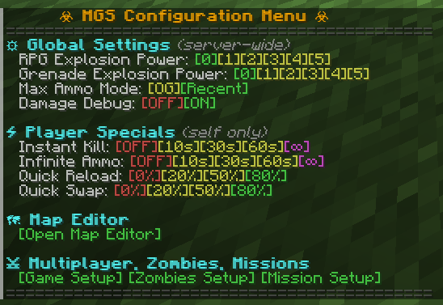
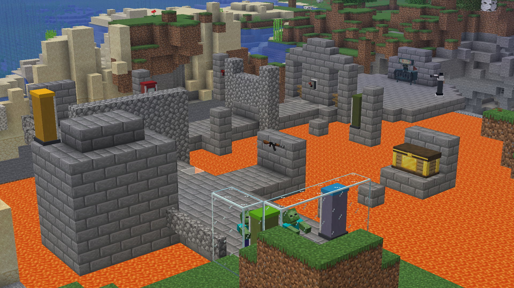

# MC Guns System

[](https://github.com/Stoupy51/MC_Guns_System/releases/latest)
[](https://discord.gg/anxzu6rA9F)
[![Powered by StewBeet](https://img.shields.io/badge/Powered%20by-StewBeet-5865F2?colorA=%23E00000&colorB=%2300A000&logo=)](https://stewbeet.paralya.fr/)

Guns, Call of Duty style game modes and a Zombies mode for Minecraft 26.3, as a datapack and a resource pack. No mods.

It is a rewrite of [MGS 4.2 by TheBradqq](https://www.youtube.com/watch?v=Ia5Mlkn6ipM), whose models, textures and sounds it mostly reuses. The rest is new.



## Install

1. Download the latest release.
2. Put `MCGunsSystem_datapack_with_libs.zip` in the world's `datapacks` folder.
	It bundles Bookshelf, Smithed Actionbar and the other libraries it needs.
3. Enable `MCGunsSystem_resource_pack_with_libs.zip` as a resource pack.
4. Open the world, or restart server.
5. Run `/function mgs:config` to open the admin menu, and start a game from Game Setup.

## Commands

| Command                            | For       | What it does                                                                                           |
|------------------------------------|-----------|--------------------------------------------------------------------------------------------------------|
| `/function mgs:config`             | operators | Admin menu: start a game, open the map editor, server options                                          |
| `/function mgs:_give_all`          | operators | Gives every item of the pack                                                                           |
| `/loot give @s loot mgs:i/<item>`  | operators | Gives one item, for example `mgs:i/ak47`                                                               |
| `/trigger mgs.player.config set 1` | everyone  | Player options, stats, leaderboards and Zombies knife camos. The Quick Actions key opens the same menu |
| `/function mgs:zombies/recover`    | operators | Unsticks a Zombies round that stopped progressing                                                      |

## Weapons

About thirty guns, [listed here](https://github.com/Stoupy51/MC_Guns_System/blob/main/GUNS.md) (pistols, SMGs, rifles, LMGs, shotguns, snipers, the RPG-7 and the Ray Gun), plus frag, semtex, smoke and flash grenades, and a knife with three Zombies upgrades.

- Hitscan bullets with spread, damage falloff and headshots. Rockets travel and explode.
- Each gun keeps its original fire modes (auto, semi, burst, pump). Drop the gun (`Q`) to switch.
- Magazines and reserve ammo, quick swap and quick reload, recoil, ejected casings, an ammo HUD in the actionbar.
- Shaders for the scope zoom, the muzzle flash, crosshair spread and low health.
- Every gun has Pack-a-Punch stats for Zombies.

https://github.com/user-attachments/assets/a8094f23-320a-4708-8b7c-132a2f3dc7c4

## Multiplayer

Six game modes: Free For All, Team Deathmatch, Domination, Hardpoint, Search and Destroy and Demolition.

Players pick a class before each life. A few balanced classes ship with the pack, and a pick-10 editor builds custom ones with perks. Custom classes can be made public, browsed, filtered, liked and set as default. Missions use the same classes.

Kills and wins give XP towards a Multiplayer level, and challenges unlock as advancements.

https://github.com/user-attachments/assets/e6f96ed9-383e-48d2-8c2b-bb47300bba42

## Missions

Co-op PvE. Every enemy placed on the map spawns at the start, a compass points at the remaining ones, and the mission ends when none is left. Leaderboards keep the best time per map.

## Zombies

Round-based survival in the style of Black Ops. One map ships with the pack, Kino der Toten.

- Zombies get faster and tougher by round. Special zombies join at round 5 (fast), 10 (tank), 15 (armed with a gun) and 20 (an aura zombie that shields the horde). Special rounds bring hounds, and every 10th round from round 8 is a chicken jockey round.
- Points from kills and repairs pay for doors, wallbuys, the power switch, traps and the Mystery Box.
- 14 perks: Juggernog, Speed Cola, Double Tap, Quick Revive, Mule Kick, Stamin-Up, PhD Flopper, Deadshot Daiquiri, Timeslip, Electric Cherry, Tombstone, Who's Who, Dying Wish and Widow's Wine, from their machines or from Der Wunderfizz.
- Pack-a-Punch, barricades, downs and revives, monkey bombs.
- 11 power-ups: Max Ammo, Insta Kill, Double Points, Carpenter, Nuke, Unlimited Ammo, Random Perk, Free PAP, Cash Drop, Fire Sale and Bonfire Sale.
- A run survives players disconnecting and a server restart, and resumes when they come back.
- Leaderboards keep the best round per map and player count. The Zombies level unlocks knife camos.

https://github.com/user-attachments/assets/69d14336-9af0-47ef-a5da-538b0f668787

One Multiplayer match, one Missions run and one Zombies run can play on the same server at the same time without seeing each other. Two games of the same mode cannot.

## Leaderboards in the world

Place a repeat command block, set it to Always Active, and make it run one of these:

```mcfunction
function mgs:leaderboard/level_zb
function mgs:leaderboard/level_mp
function mgs:leaderboard/zb_map {map:"kino_der_toten",players:"all"}
function mgs:leaderboard/mi_map {map:"<mission id>"}
```

The board floats above the block while a player is within 24 blocks.
Untick the block's Track Output, or run `/gamerule command_block_output false`, or it fills the operators' chat.

## Map editor

Maps of all three modes are made in game. Open it from `/function mgs:config`, Game Setup, then pick a mode and a map, or create one.

The editor gives spawn eggs, one per kind of element. Place them where the element goes:

| Mode        | Elements                                                                                                      |
|-------------|---------------------------------------------------------------------------------------------------------------|
| Multiplayer | red, blue and shared spawns, objective points for Search and Destroy, Domination and Hardpoint                |
| Missions    | player spawns, enemies (with the function that sets each one up)                                              |
| Zombies     | player, zombie and special spawns, wallbuys, doors, traps, perk machines, Mystery Box spots, the power switch |
| All         | base coordinates, boundary corners, out-of-bounds points                                                      |

The Configure egg lists an element's fields in chat: a door's price and the doors it opens with, a trap's duration and cooldown, a perk machine's perk and price. Spawns and Mystery Box spots also get a form, and a spawn's activation box shows as particles.
The Destroy egg removes the nearest element, and its chat message has a Revert button.

Place the base coordinates first: every position is saved relative to them, so a map works in any world once its base is placed.

https://github.com/user-attachments/assets/7b429b68-c476-4b08-98ce-0fa53cb72608



### Ship a map with the pack

1. Save the map in the editor.
2. Print it with `/data get storage mgs:maps <mode>[{id:"<id>"}]`, where `<mode>` is `multiplayer`, `zombies` or `missions`.
3. Paste the compound in the generator, next to the existing maps, behind a check on its id:

	```mcfunction
	execute unless data storage mgs:maps multiplayer[{id:"hijacked"}] run data modify storage mgs:maps multiplayer append value {...}
	```

| Mode        | File                                 | Registered by                | Runs                        |
|-------------|--------------------------------------|------------------------------|-----------------------------|
| Multiplayer | `src/functional/multiplayer/maps.py` | `#mgs:maps/register`         | on every load               |
| Zombies     | `src/functional/zombies/maps.py`     | `#mgs:zombies/register_maps` | at every Zombies game start |
| Missions    | `src/functional/missions/maps.py`    | none yet                     |                             |

A world that already has a map with that id keeps its own copy, so edits made in game survive a reload.
To push a changed built-in map to a world, remove the stored one first, for example `/data remove storage mgs:maps multiplayer[{id:"hijacked"}]`, then `/reload`.

Another datapack can ship maps the same way, from its own function in `#mgs:maps/register` or `#mgs:zombies/register_maps`.

### Map scripts

A map runs its own commands from the function tags `#mgs:maps/<script>_script`, where `<script>` is `start`, `tick`, `join`, `leave`, `respawn` or `power` (Zombies, when the power turns on). They run at the map's base coordinates.
Every map adds to the same tags, so each script first checks that its game is running on its own map. `maps/multiplayer/hijacked/calls/` and `maps/zombies/kino_der_toten/calls/` show how.

## Build from source

Needs [uv](https://docs.astral.sh/uv/) 0.9 or newer, which fetches Python 3.14.

```bash
uv sync
uv run stewbeet
```

The datapack, the resource pack and the four zips land in `build/`, which is tracked in git and never edited by hand.
`build_copy_destinations` in `beet.yml` copies them to the author's Windows folders. Elsewhere StewBeet prints a warning and goes on.

Checks, all run with `uv run python scripts/verify.py <command>`:

| Command                                    | What it does                                                                          |
|--------------------------------------------|---------------------------------------------------------------------------------------|
| `baseline`                                 | Saves `build/` to compare against                                                     |
| `check [--diff]`                           | Rebuilds and lists what changed since the baseline, ignoring comments and blank lines |
| `validate`                                 | Parses every function with mecha and lists missing and unreachable resources          |
| `server --java <absolute path to Java 25>` | Loads and reloads the pack in a real 26.3 server                                      |
| `lint`                                     | ruff, pyright strict, complexipy                                                      |

After changing XP awards in `src/functional/progression/awards.py` or a challenge threshold, run `/function mgs:v<version>/progression/recompute_all` in game (for example `mgs:v5.3.0/...`). It rebuilds every online player's levels and challenges from their banked XP.

### Where things are

- `src/setup_definitions.py` registers every item from the stats in `src/config` and the builders in `src/database`.
- `src/link.py` writes every function, one package of `src/functional/` per system: `weapon`, `core` (bounds, maps, spawning, menus shared by the modes), `progression`, `stats`, `multiplayer`, `missions`, `zombies`, `map_editor`, `shaders`.
- `assets/` holds textures, sounds and shaders. `specs/` holds one folder per planned feature, and its README lists their state.

